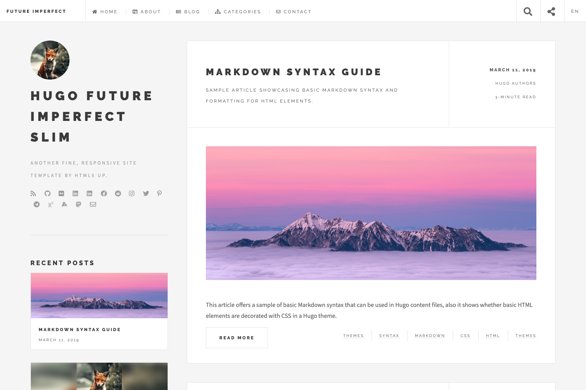
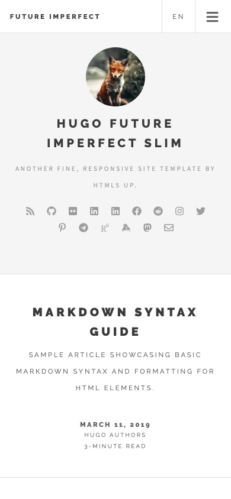

# Hugo Future Imperfect Slim, revived

A Hugo theme based on HTML5 UP's [Future Imperfect](https://html5up.net/future-imperfect).

This is a fork of [pacollins/hugo-future-imperfect-slim](https://github.com/pacollins/hugo-future-imperfect-slim), which was archived in April 2022 and no longer builds with current Hugo. The fork:

1. **Makes the theme build again** with current Hugo and Dart Sass.
2. **Reworks the layout on top of the original design.** Slim had moved away from HTML5 UP's Future Imperfect in spacing, shadows and alignment. Here it goes back to the original values, on desktop, tablet and phone.
3. **Adds a few small features and fixes the bugs found on the way**, listed below.

Thanks to [Patrick Collins](https://github.com/pacollins) and everyone who contributed to Hugo Future Imperfect Slim: this fork only exists because of that work. The design is [Future Imperfect](https://html5up.net/future-imperfect) by [HTML5 UP](https://html5up.net) ([live demo of the original](https://html5up.net/uploads/demos/future-imperfect/)).



## Contents

- [Requirements](#requirements)
- [Getting started](#getting-started)
- [Features](#features)
- [What is new in this fork](#what-is-new-in-this-fork)
- [Coming from the archived theme](#coming-from-the-archived-theme)
- [Configuration added by this fork](#configuration-added-by-this-fork)
- [Customizing](#customizing)
- [Known limits](#known-limits)
- [Credits](#credits)
- [License](#license)

## Requirements

- **Hugo 0.158 or later.** Tested with Hugo 0.170.1. Earlier versions lack functions the theme now uses; versions between 0.158 and 0.170 have not been tested.
- **Dart Sass.** Hugo no longer bundles a Sass compiler, and the theme's stylesheet is written in Sass. See [Hugo's instructions](https://gohugo.io/functions/css/sass/#dart-sass). Tested with Dart Sass 1.108.2.

On macOS with Homebrew:

```shell
brew install hugo
brew install sass/sass/sass
```

For GitHub Pages, Netlify and other hosts, install Dart Sass in the build as the [Hugo hosting guides](https://gohugo.io/host-and-deploy/) show.

## Getting started

Add the theme to your site as a git submodule:

```shell
git submodule add https://github.com/onavascuez/hugo-future-imperfect-slim.git themes/hugo-future-imperfect-slim
```

Copy `exampleSite/config.toml` to the root of your site as a starting point, set `theme = "hugo-future-imperfect-slim"` in it, and run:

```shell
hugo server
```

The site is served at [localhost:1313](http://localhost:1313).

To update the theme later:

```shell
git submodule update --remote --merge
```

`exampleSite` is a complete sample site, with posts, an about page, a contact page and several languages. To see the theme with it, from the theme folder:

```shell
hugo server --source exampleSite --themesDir ../.. --theme hugo-future-imperfect-slim
```

The options of `config.toml` are documented in the [wiki of the original repository](https://github.com/pacollins/hugo-future-imperfect-slim/wiki/config.toml). What this fork adds or changes is described [below](#configuration-added-by-this-fork).

## Features

Inherited from Hugo Future Imperfect Slim:

- Responsive layout built with CSS Grid: sidebar and posts side by side on wide screens, a single column on tablets and phones.
- Sidebar with intro (picture, title, tagline, social icons), recent posts, categories and an about block.
- Post header with title, subtitle, date, author and reading time; featured image; table of contents on long posts; categories and tags.
- Client-side search with [Lunr](https://lunrjs.com), without any server.
- Multilingual sites, with a language menu. Translations: Catalan, Chinese (simplified and traditional), Dutch, English, French, German, Indonesian, Japanese, Korean, Polish, Portuguese, Spanish and Turkish.
- Comments with Disqus, Utterances or Staticman.
- Share buttons, RSS, Open Graph and Twitter card metadata, favicons.
- Syntax highlighting with highlight.js, and image galleries with the `fancybox` shortcode.
- About and contact page layouts. The contact form posts to Netlify Forms or to a form service of your choice.
- Options for how featured images fill their frame (`imageStretch`, `removeBlur`).
- Your own CSS and JavaScript on top of the theme (`static/css/add-on.css`, `static/js/add-on.js`).

## What is new in this fork

### It builds again

- Replaced the templates and functions Hugo removed: the internal Google Analytics and Disqus templates, `.Site.Author`, `.Site.Social`, `.Site.LastChange`, `.Site.Languages`, `.Language.LanguageName`, `.Site.Data`, and `.Render "date"` in the search index.
- The stylesheet is compiled with Dart Sass through `css.Sass`. The Sass code uses the `sass:color`, `sass:list` and `sass:math` modules instead of deprecated global functions.
- Updated `exampleSite` to the current configuration keys, and removed a Twitter shortcode Hugo dropped.
- Builds without warnings on Hugo 0.170.1.

### Closer to the original design

Rules that restore the values of HTML5 UP's Future Imperfect:

- Header without drop shadow, only its 1px bottom border.
- Posts with a 1px border, the original inner spacing (3em, and 1.5em on the sides on phones) and no maximum width.
- Small uppercase subtitle under the post title, and a 17em column for the date.
- Featured image inside the post padding instead of edge to edge.
- Categories and tags on one line, without icons. On wide screens the "read more" button sits on the left with them on its right. On phones they go centered above a full-width button.
- Left-aligned intro and sidebar on wide screens, with a larger site title.
- Body text in the original mid grey, left-aligned instead of justified.
- Original page padding, and one gutter for every block on phones and tablets.
- On phones, previous and next buttons are stacked and show the post titles.

They live in a single section at the end of `assets/scss/main.scss`, titled "Closer to the original design". Delete that section to get the Slim look back.



### New features

- **Featured posts in the sidebar**, optional, above the recent posts.
- **Search:**
  - The index is requested the first time the search is opened, not on every page load.
  - Accents are ignored: `mon` finds `món`.
  - Words are also split on apostrophes: `aigua` finds `l'aigua`.
  - Words match from their beginning, so `check` finds `checklist` while typing.
  - Matches in the title rank first.
  - Stop words for your language can be configured. Lunr only knows the English ones.
- **More options for the sidebar:** hide the "See More" button, choose where the about block's button points, and keep featured posts out of the recent list.
- **Catalan translation.**
- Dates follow Hugo's localized formats, so they read correctly in every language without a format string per language.

### Bugs fixed

- Post summaries were printed as escaped HTML in lists.
- The search never showed its "no results" message, and a malformed query broke it.
- `intro.hideWhenSingleColumn` had no effect.
- The about block's button always pointed to `/about`.
- "Search" and "Share" in the menu, and the search messages, were hardcoded in English.
- Long unbreakable content could widen the whole page on phones.

### Removed

- The banner announcing the breaking changes of version 2.0.0 (July 2020), which showed on the home page when browsing on `localhost`.
- The cached stylesheet committed under `exampleSite/resources`, which current Hugo does not use.

## Coming from the archived theme

Your site needs these changes in its configuration:

| Before | Now |
|---|---|
| `paginate = 3` | `[pagination]` with `pagerSize = 3` |
| `googleAnalytics = "..."` | `[services.googleAnalytics]` with `id = "..."` |
| `disqusShortname = "..."` | `[services.disqus]` with `shortname = "..."` |
| `[social]` | `[params.social]` |
| `LanguageCode` and `LanguageName` in each language | `locale` and `label` |

And two things outside the configuration:

- Install Dart Sass. Hugo Extended is no longer needed.
- The look changes, because of the rules described in [Closer to the original design](#closer-to-the-original-design).

## Configuration added by this fork

```toml
[params.sidebar]
  # Optional "Featured Posts" block above the recent posts. 0 disables it.
  featuredAmount          = 0
  # Front matter parameter that marks a post as featured: pinned = true
  featuredParam           = "pinned"
  # Leave featured posts out of the recent posts list
  recentExcludesFeatured  = false
  # Hide the "See More" button under the recent posts
  hideViewMore            = false
  # Page the button of the about block links to
  aboutLink               = "about"

[params.search]
  # Stop words of the site language, ignored by the search
  stopWords               = []
```

Strings added to the translation files, in English, Spanish, Catalan and French. The other languages show them in English until someone translates them:

| Key | Used for |
|---|---|
| `featured_posts` | Title of the featured posts block |
| `search`, `share` | Labels in the menu |
| `search_no_results`, `search_error` | Messages of the search |

## Customizing

To change a template, do not edit the theme. Copy the file to the same path in your own site and edit that copy: Hugo uses yours first. For example, `themes/hugo-future-imperfect-slim/layouts/partials/site-sidebar.html` becomes `layouts/partials/site-sidebar.html` in your site.

For styles and scripts, use `static/css/add-on.css` and `static/js/add-on.js` in your site, or list your own files in the `cssFiles` and `jsFiles` parameters.

The [wiki of the original repository](https://github.com/pacollins/hugo-future-imperfect-slim/wiki) documents the [shortcodes](https://github.com/pacollins/hugo-future-imperfect-slim/wiki/shortcodes) and [Staticman](https://github.com/pacollins/hugo-future-imperfect-slim/wiki/staticman.yml).

## Known limits

- **Not everything has been tested again.** The fork was checked with the example site and with one real site: posts, lists, sidebar, search, several languages and the three screen sizes. Disqus, Utterances, Staticman, the contact form, the share buttons and `enableCDN = true` build without errors but have not been tried against the real services.
- **The search stems words with English rules**, so in other languages plurals and verb forms are not matched to each other. Matching from the beginning of a word covers many of those cases.
- **Lunr is loaded on every page**, about 100 KB. Only the index is loaded on demand.
- **No dark mode.** `assets/css/dark.css` exists in the theme but it is not wired to anything.

Issues and pull requests are welcome.

## Credits

- [HTML5 UP](https://html5up.net) designed [Future Imperfect](https://html5up.net/future-imperfect).
- [Julio Pescador](https://github.com/jpescador) ported it to Hugo as [hugo-future-imperfect](https://github.com/jpescador/hugo-future-imperfect).
- [Patrick Collins](https://github.com/pacollins) rebuilt that port with CSS Grid and newer Hugo functions as [Hugo Future Imperfect Slim](https://github.com/pacollins/hugo-future-imperfect-slim), with [StatnMap](https://github.com/statnmap) adding multilingual support, and many [contributors](https://github.com/pacollins/hugo-future-imperfect-slim/graphs/contributors).
- This fork is maintained by [Oriol Navascuez](https://github.com/onavascuez).

## License

Released under the [Creative Commons Attribution 3.0 License](https://creativecommons.org/licenses/by/3.0/), the same terms as HTML5 UP's Future Imperfect. See [LICENSE.md](LICENSE.md). If you use the theme, keep the credit to HTML5 UP that it prints in the footer.
